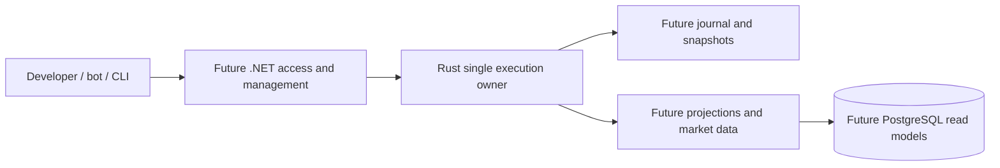

# Cinis

[](https://github.com/cuthanhcam/cinis/actions/workflows/documentation.yml)
[](https://github.com/cuthanhcam/cinis/actions/workflows/engine.yml)
[](https://github.com/cuthanhcam/cinis/actions/workflows/platform.yml)
[](https://github.com/cuthanhcam/cinis/actions/workflows/ops.yml)
[](https://github.com/cuthanhcam/cinis/actions/workflows/repository.yml)

Cinis is a Rust/.NET trading infrastructure lab for deterministic order execution, financial correctness, durable recovery, and reproducible performance research.

The project serves developers who want to study one coherent execution system, inspect its decisions, and reproduce its behavior. It combines a Rust execution core, a future .NET management/gateway platform, and a research toolkit. The name Cinis replaces the earlier working name Cineres.

## Current state and boundaries

| Area | Delivered | Remaining |
| --- | --- | --- |
| Execution | GTC matching plus synthetic funding, reservations, settlement/release, balanced ledger, sequenced market state, and command idempotency | Durable recovery and network integration |
| Verification | 61 Rust tests plus one doctest; matching reference corpus of 8,192 commands; financial corpus of 1,024 fresh attempts plus retries/conflicts | Network, persistence, and recovery evidence |
| Developer operations | Windows task runner, unique-run logs/metadata, timeout/owned-process cleanup, portable repository checks | Persistent-service lifecycle with real gateway |
| CI | Linux/Windows engine checks, Windows ops tests, documentation/naming, pinned workflow validation, exact-SHA integration gate | Hosting protections must be configured separately |
| Platform | .slnx with five production/five test projects; trusted local grant/cancel use cases, experimental framing, health host, 37 .NET tests | API-key authentication, Rust transport, database/projections and financial HTTP endpoints |

The current CLI executes synthetic financial state in memory, with retained command results and reconciled balances/ledger. Permissions are a trusted local API contract, not network authentication. Restart loses everything; no persisted retry or recovery guarantee exists. No release, throughput, latency, or zero-allocation claim is made.

## Quick start

Prerequisites: Git, rustup with the pinned Rust 1.95.0 and rustfmt/Clippy, Python 3.11+, and the native linker/build tools for your host. Windows automation requires Windows PowerShell 5.1+; local and hosted evidence identifies the tested host. First workflow validation downloads a checksum-pinned actionlint binary from its official GitHub release.

```sh
git clone https://github.com/cuthanhcam/cinis.git
cd cinis
git switch develop
cargo run --locked --manifest-path src/engine/Cargo.toml --bin cinis-demo
```

Expected flow: fund buyer with 1,000 quote and seller with 10 base; sell 10 at 100; buy 4; retry without another financial effect; cancel 6. Final buyer has base 4/quote 600 and seller base 6/quote 400, with no holds and an empty book. The CLI prints stable event/posting IDs and checks reconciliation. All state disappears on process exit.

For logged Windows verification and execution:

```powershell
powershell -NoProfile -File .\ops\scripts\Invoke-Cinis.ps1 -Task Verify
powershell -NoProfile -File .\ops\scripts\Invoke-Cinis.ps1 -Task Run
powershell -NoProfile -File .\ops\scripts\Get-CinisLogs.ps1 -Tail 50
```

Scripts resolve the repository from their own location and can be called by absolute path from another directory. Logs live under ignored artifacts/logs/<run-id>/, with separate stdout/stderr, step metadata, and run.json. See [setup](docs/development/setup.md), [local runbook](docs/operations/local-development.md), and [debugging](docs/operations/logging.md).

For .NET, use the [platform guide](docs/development/platform.md) or `powershell -NoProfile -File ops/scripts/Invoke-Cinis.ps1 -Project Platform -Task Verify`. Platform Run is a finite smoke; Serve runs a bounded foreground host with logs. Readiness stays false until Rust integration. SDK 10.0.301 is declared in global.json with same-band patch roll-forward.

## Direct verification

```sh
cargo fmt --manifest-path src/engine/Cargo.toml --check
cargo clippy --locked --manifest-path src/engine/Cargo.toml --all-targets -- -D warnings
cargo test --locked --manifest-path src/engine/Cargo.toml
python ops/scripts/check_docs.py
python ops/scripts/check_naming.py
python ops/scripts/check_workflows.py
python -m unittest discover -s ops/tests -v
git diff --check
```

Windows-only process tests explicitly skip on other hosts; portable naming/CI-gate tests still run. Full required hosted workflows must pass on the integration commit before develop is advanced. See [CI and integration](docs/development/ci.md); local success alone does not meet that gate.

## System direction

Start with the [architecture blueprint](docs/architecture/blueprint/README.md) and its [offline interactive Atlas](docs/architecture/blueprint/architecture-atlas.html): current/target views, authority boundaries, order/ledger/recovery flows, technology trade-offs, and business/technical decisions awaiting review.



ExecutionCore now owns in-memory sequenced orders, balances, reservations, settlement, ledger state, and deduplication. .NET owns identity, permissions, management, and gateway access. Read models never independently approve spending. See [architecture](docs/architecture/overview.md), [state ownership](docs/architecture/state-ownership.md), [ledger](docs/architecture/ledger.md), and [core API](docs/development/core-api.md).

## Repository map

| Path | Responsibility |
| --- | --- |
| src/engine/ | Implemented Rust library, demo binary, and core integration runners |
| src/platform/ | Implemented .NET solution/modules/tests and health-only scaffold host |
| tests/fixtures/ | Shared versioned command/event/final-state examples |
| ops/config/, ops/scripts/, ops/tests/ | Task registry, all repository automation, and automation tests |
| docs/product/, docs/domain/, docs/architecture/ | Requirements, exact semantics, ownership/contracts, ADRs |
| docs/verification/, docs/delivery/ | Evidence strategy/reports, milestones, single canonical backlog |
| docs/development/, docs/operations/, docs/templates/ | Contributor guides, runbooks, reusable document structure |
| research/ | Experiment templates, findings, and reproducible investigations |
| tools/, deploy/ | Guides for future concrete research tools and deployment artifacts |
| .github/ | Workflows, code ownership, dependency updates, issue/PR templates, support |
| artifacts/ | Ignored local/CI diagnostics and downloaded verification tools |

See the [Rust engine development guide](docs/development/rust-engine.md), [layout](docs/development/repository-layout.md), [naming](docs/development/naming-conventions.md), and [documentation standard](docs/development/documentation-guide.md). There is one docs/ tree, full documentation topic names such as operations/, and one short ops/ automation root.

## v0.1 acceptance and roadmap

Target: one spot market, synthetic funds, limit GTC, reservation/settlement, account-scoped API access, durable recovery, market data, and reproducible baseline reports. Full acceptance is funding -> sell -> partial fill -> retry without another effect -> restart/recover -> cancel remainder -> reconcile balances/ledger.

The in-memory financial journey is implemented, but the full restart journey remains incomplete. Next gates are the .NET/Rust protocol spike and gateway integration, followed by journal/recovery. M0 cross-language discovery remains open. Advanced IPC, zero-allocation, replication, blockchain, and real assets remain deferred. [Scope](docs/product/scope-v0.1.md), [requirements](docs/product/requirements.md), and [backlog](docs/delivery/backlog.md) define the working plan.

## Contributing, support, and licensing

Start with [CONTRIBUTING](CONTRIBUTING.md) and [Git workflow](GIT_GUIDELINES.md). Feature/fix/docs/chore branches are tested on GitHub; develop receives the exact tested integration commit; main receives a maintainer-reviewed PR. [Commit conventions](COMMIT_MESSAGE_GUIDELINES.md) and [code of conduct](CODE_OF_CONDUCT.md) apply.

Use [support guidance](.github/SUPPORT.md) and issue templates for reproducible questions/bugs. Report sensitive issues according to [SECURITY](SECURITY.md). No hosted service or response-time SLA is provided.

[Documentation index](docs/README.md) is the full navigation entry point. Licensed under [MIT](LICENSE).
