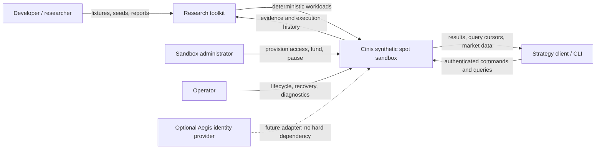
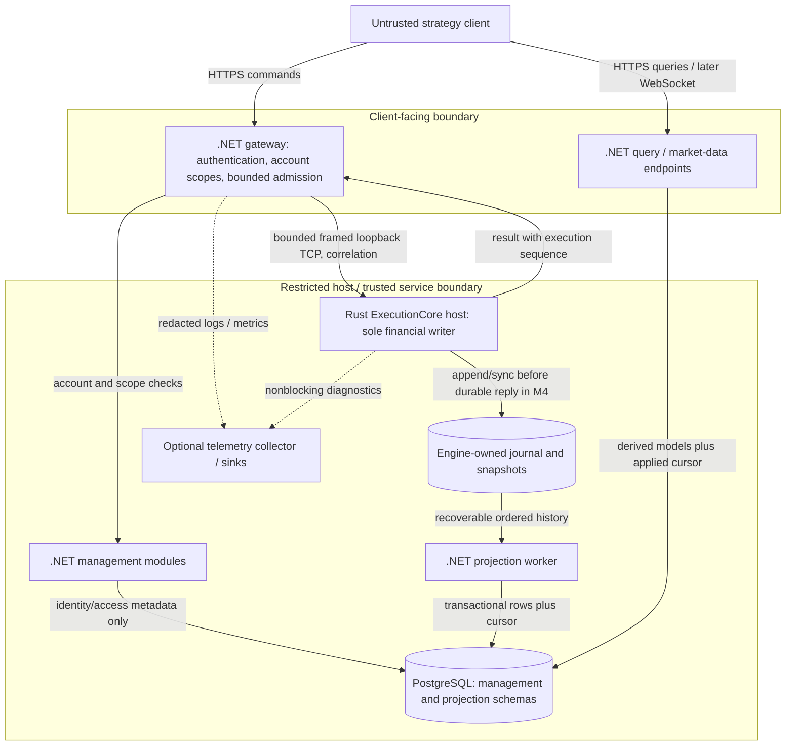
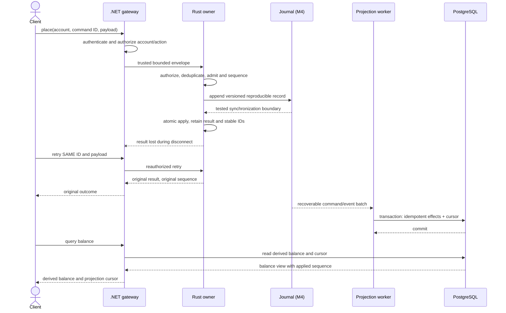
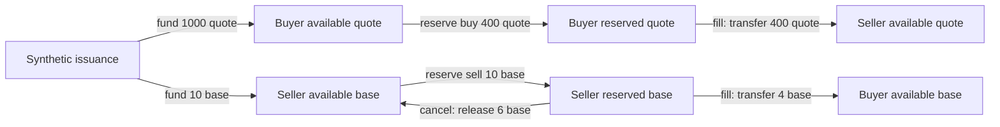
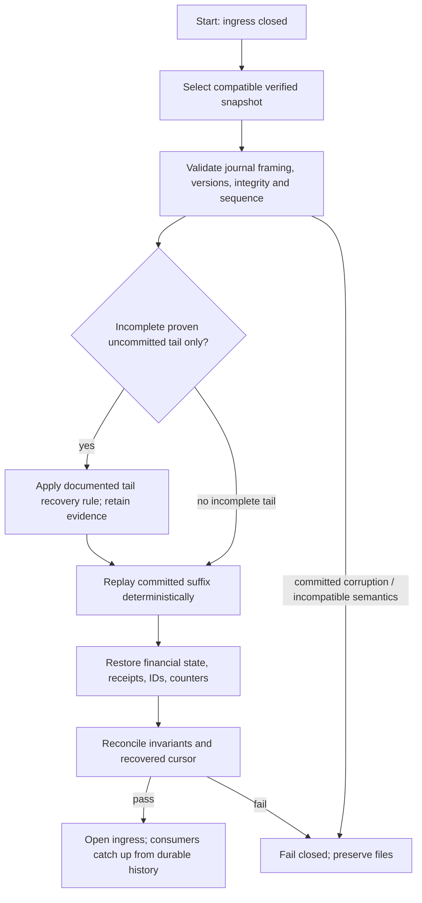
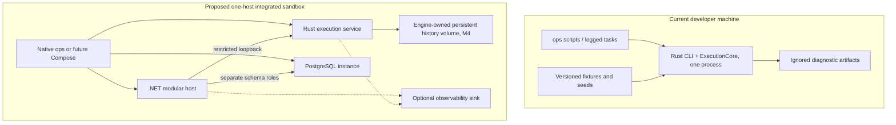
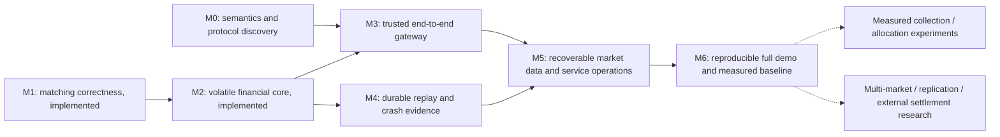
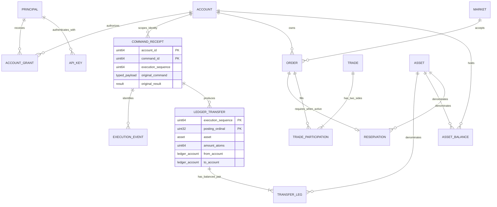

# Architecture diagram catalog

Purpose: communicate structure, authority, time ordering, failure boundaries, and expansion gates.
Status: mixed implemented/target views, explicitly labeled below. Owner: project maintainer. Reviewed: 2026-10-15; baseline 6cf0828.

These are C4-inspired context/container/component views plus dynamic and deployment views; they are not a formal C4 tooling export. Arrows mean the labeled interaction. PostgreSQL is never an execution balance authority. [Architecture Atlas](architecture-atlas.html) provides an offline interactive companion. Detailed rules remain in [solution architecture](solution-architecture.md) and the linked contracts.

## D1: System context - target v0.1

Only the local CLI/library and part of the research verification exist today. Aegis is Deferred. Real venues, custody, and blockchains are outside this system boundary.

## D2: Containers and trust - proposed integrated sandbox

Journal-to-worker is a logical recoverable feed, not permission for .NET to parse arbitrary private files. The export API/file feed and versioning are open decisions. Gateway, management, query and worker can start inside one modular .NET process. The collector is optional and absent today.

## D3: Execution internals - implemented M2

```mermaid
flowchart LR
    Caller[Trusted local caller] --> Admission[Identity and permissions]
    Admission --> Receipts[Account / command receipt lookup]
    Receipts -->|same payload| Original[Original historical response]
    Receipts -->|new key and capacity| Sequence[Global command sequence]
    Sequence --> Tentative[Clone tentative execution state]
    subgraph Atomic[Single-owner atomic financial transition]
        Tentative --> Preflight[Validate, reserve, match preflight]
        Preflight --> Matcher[Vec-backed price-time matcher]
        Matcher --> Ledger[Settlement / release ledger transfers]
        Ledger --> Verify[Reconcile balances, holds, ledger]
    end
    Verify -->|success| Commit[Swap financial state]
    Verify -->|business rejection| Keep[Keep original financial state]
    Commit --> Retain[Retain result and advance sequence]
    Keep --> Retain
    Retain --> Reply[Volatile response with stable IDs]
```

This is a responsibility diagram, not exact function-call order for every command. Validation/matching/settlement failures also take the rejection path. Unauthorized/conflicting/capacity admission errors return before allocation of a sequence. Receipt returns require current permission. No external event publisher or persistence is present.

## D4: Submit, lost reply, retry, projection - target M3/M4

A business rejection can also be a retained outcome. Journal admission facts/configuration and event reconstitution must be specified before M4. A retry returning historical events must not emit another live financial batch. M3 alone remains volatile.

## D5: Ledger movements - accepted zero-fee example

Synthetic initial state: buyer 1,000 quote; seller 10 base. Seller rests 10 at 100, buyer buys 4 at 100, seller cancels the remaining 6. One lot is one base atom; one tick is one quote atom per base atom in this sandbox.

Final buyer base 4/quote 600, seller base 6/quote 400; both reserved balances zero, book empty. Seven transfers, each with balanced per-asset source/destination legs. Funding uses issuance as the explicit counterparty. Price-improved buys additionally release excess quote; this example has no price improvement. See [ledger](../ledger.md) for the canonical posting model.

## D6: Order state machine - accepted business model

```mermaid
stateDiagram-v2
    [*] --> Submitted
    Submitted --> Rejected: preflight/business failure; no financial mutation
    Submitted --> Open: accepted remainder, no fills
    Submitted --> PartiallyFilled: fills with remainder
    Submitted --> Filled: all quantity executed
    Open --> PartiallyFilled: later incoming fill
    Open --> Filled: later complete fill
    PartiallyFilled --> PartiallyFilled: later fill leaves remainder
    PartiallyFilled --> Filled: remaining quantity executed
    Open --> Cancelled: owner cancel; release hold
    PartiallyFilled --> Cancelled: owner cancel remaining; release hold
    Rejected --> [*]
    Filled --> [*]
    Cancelled --> [*]
```

Submitted is a conceptual request stage, not a persisted order state in the current API. Admission errors are outside this state machine. Unknown cancel rejects; an owned terminal order produces its terminal response without new effects. No amendment/reopen exists. Pausing gates new placement, not already-final fills; cancels remain policy-permitted subject to accepted capacity limits.

## D7: Recovery and publication - intended M4

No snapshot can mean replay from a valid genesis/configuration record; an invalid snapshot must not silently hide committed corruption. Storage checksums detect corruption, not malicious tampering. Recovery never silently resets balances or drops committed receipts. All of this remains unimplemented.

## D8: Deployment - current versus target

HTTPS termination, ports, secrets provider, storage paths, OS support and backup policy must be decided with actual services. The current log runner does not provide persistent-service readiness, restart supervision or storage recovery. A single host has a single-host failure domain; it is not HA.

## D9: Evolution gates - capability chart, not calendar schedule

M0 remains open for cross-language discovery despite M1/M2 implementation. M3 network results cannot be advertised as durable before M4. Deferred extensions need their own business and authority review. [Backlog](../../delivery/backlog.md) is canonical; this chart makes no dates or effort promises.

## D10: Logical domain relationships - authority model, not a SQL schema

PRINCIPAL/API_KEY/ACCOUNT_GRANT are proposed management concepts, not existing tables. Account grants/revocation still need BD-01/02 review. Rust owns orders, balances, holds, execution receipts/events and ledger transfers; their PostgreSQL equivalents are derived projections. The model's ACCOUNT is the stable account identity shared across the boundary, not a shared writable financial row. The accepted engine represents a transfer as source/destination fields; TRANSFER_LEG explains balanced accounting rather than claiming a separate implemented entity. Issuance is a ledger counterparty, not a normal customer account. Trades have exactly two order participations in the business model; Mermaid cardinality alone does not enforce that constraint. See [state ownership](../state-ownership.md) and [ledger](../ledger.md).
