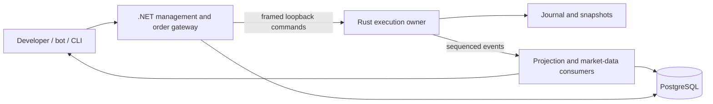

# Architecture overview

Status: Rust in-process execution and financial CLI implemented; .NET/consumer/database processes remain planned.

For the complete current/target design, read the [architecture blueprint](blueprint/README.md), [diagram catalog](blueprint/diagrams.md), and [offline interactive Atlas](blueprint/architecture-atlas.html). Technology choices, business questions and review gates are explicit in that package. The diagram and recovery/source column below describe the target; current authoritative execution state is memory only.

| State | Authoritative writer | Recovery/source |
| --- | --- | --- |
| Book, orders, balances, holds, execution ledger, command results | Single Rust execution process | Journal plus snapshot |
| Users, API keys, scopes, administrative metadata | .NET management | Management database |
| Trading-effective market state | Rust sequenced commands | Execution journal |
| Order/trade/balance query models | Idempotent consumers | Execution history |
| Client market view | Market-data consumer | Snapshot plus ordered deltas |

Gateway authenticates, authorizes account access, validates shape, and forwards commands. It cannot independently approve spending. .NET is part of the end-to-end order path; measure its overhead.

Order flow: authenticate -> authorize -> validate -> deduplicate/sequence -> journal -> durability boundary -> deterministic apply -> result/events. Retry lost responses with the same command ID. Consumers catch up from durable execution history and tolerate repeats.

Recovery: validate a compatible snapshot, replay journal suffix, verify invariants, restore deduplication/counters, reopen ingress. See [durability](durability.md) and [protocol](protocol.md).

Local target: .NET process, Rust process, PostgreSQL, CLI/consumers. Use framed TCP loopback for the Windows-friendly first spike. Ports, versions, database schema, and orchestration remain open tasks. Slow market-data clients use bounded queues and resync; execution never waits directly for WebSocket clients. Shared memory and multi-writer matching are deferred.

## Platform architecture review

Before creating .NET projects, review the [platform architecture plan](platform-architecture.md) and [phased implementation sequence](platform-implementation-plan.md). Proposed approach: modular monolith, consumer-owned ports/adapters, vertical use-case slices and CQRS across execution/query boundaries. [ADR-0007](decisions/0007-platform-architecture.md) remains Proposed; this documentation does not accept access/protocol policies or implement a gateway.
