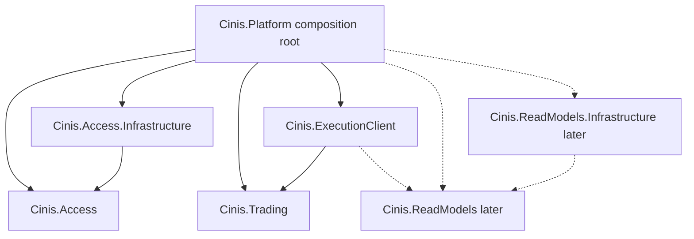
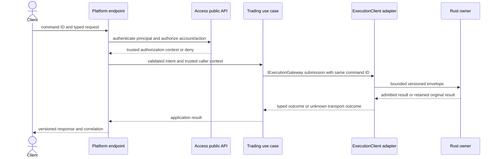

# .NET platform architecture plan

Purpose: select an understandable architecture, dependency model and scaling path before .NET source is created.
Status: Architecture baseline accepted and scaffold implemented, 2026-10-17; network/data capabilities remain planned. Owner/approver: project maintainer. The scaffold now contains the five production projects and five test projects; see the platform development guide for delivered limits.

## Recommendation

Use a **modular monolith for the .NET management platform**, **ports and adapters for external dependencies**, **vertical slices for use cases**, and **CQRS where command authority and query models differ**. Apply domain-driven design to bounded contexts and real access policies; do not recreate the Rust financial model as a second .NET domain. Preserve the existing single-writer deterministic Rust execution architecture.

These patterns answer different questions. Modular monolith defines deployment and module ownership. Ports and adapters define dependency direction. Vertical slices define how related feature code is grouped. CQRS defines command/query responsibilities. They are complementary, not four competing frameworks.

The architecture baseline is accepted, while unresolved business/access/protocol decisions remain open. The architecture plan itself does not establish a financial gateway, database or performance guarantee; delivered bootstrap capabilities are tracked separately. [ADR-0007](decisions/0007-platform-architecture.md) records alternatives and acceptance scope; the [implementation sequence](platform-implementation-plan.md) defines readiness gates.

## Pattern portfolio and limits

| Concern | Proposed pattern | Concrete Cinis application | Limit |
| --- | --- | --- | --- |
| .NET deployment | Modular monolith | One host initially; separate Access, Trading, and later ReadModels capabilities | Rust remains a separate authority process; the whole system is not one monolith |
| Dependency direction | Ports and adapters / Clean Architecture principles | Use cases own required ports; database and Rust transport adapters implement them | No mandatory four-project template for every module |
| Feature organization | Vertical slice | CreateApiKey, AuthorizeAccount, PlaceOrder, CancelOrder each has cohesive input/handler/result/tests | Domain invariants stay in their owning policy/entity, not copied into each handler |
| Domain boundaries | Pragmatic DDD | Access owns principal/account grants and key lifecycle; Rust owns financial aggregates | Descriptive metadata does not need rich aggregates merely to satisfy a pattern |
| Commands and queries | CQRS by responsibility | Trading forwards commands to Rust; ReadModels serves derived cursored queries | No requirement for separate processes, MediatR or event sourcing |
| External integration | Anti-corruption layer | ExecutionClient maps C# application intents to a versioned Rust wire contract and maps outcomes back | Generated transport types do not leak into endpoint/domain APIs |
| Dependency injection | Explicit constructor injection / composition root | Host wires module services and adapters; scoped database work is explicit | No service locator, hidden ambient financial state, or automatic global assembly scanning by default |
| Recovery/event consumers | Idempotent application and transactional cursor | Apply one complete committed batch and its progress in a database transaction | Requires accepted feed contract; no-event rejected decisions still advance progress |
| Management integration events | Transactional outbox only when required | Future access notifications persist with their management change if reliable external publication is needed | Not a default queue for order submission; cannot make Rust commands atomic with PostgreSQL |
| Long business workflows | Explicit orchestration; saga only with real compensation needs | Provision access and synthetic funding have separate observable outcomes | A financial fill cannot be undone by pretending a network timeout failed |

Microsoft's [architecture guidance](https://learn.microsoft.com/en-us/dotnet/architecture/modern-web-apps-azure/common-web-application-architectures) explains dependency inversion and separating logical boundaries from deployment. Cinis adopts those principles selectively. Microsoft's [CQRS guidance](https://learn.microsoft.com/en-us/azure/architecture/patterns/cqrs) discusses separate read/write responsibilities and added complexity; the initial design does not require a broker or distributed CQRS framework.

## Ownership and module contracts

| Module/boundary | Owns | Public surface | Forbidden responsibility |
| --- | --- | --- | --- |
| Platform host | HTTP composition, authentication middleware wiring, endpoints, diagnostics/readiness, hosted-worker lifecycle | External versioned API; internal bootstrap | Financial decision, cross-module SQL joins for business policy, persistence entities in HTTP responses |
| Access | Account-access policy, principal grants, API-key lifecycle, revocation policy | Narrow authorization/key-management use cases and DTOs; required persistence/secret-verification ports | Rust financial account totals, holds, settlement or permission flags chosen by public clients |
| Access.Infrastructure | Access persistence, key verification/storage integration, migrations | Adapter registration and implementations of Access-owned ports | Trading decision, direct projection/engine storage edits |
| Trading | Application workflow for place/cancel/fund/pause; trusted account/action context, command correlation and unknown outcomes | Typed use-case inputs/results and IExecutionGateway port | Own book/balance tables, reserve/settle, reinterpret retained rejects |
| ExecutionClient | Version/framing, encoding, correlation, bounded pending requests, reconnect and outcome translation | Adapter registration; implements Trading-owned execution port | Authenticate arbitrary external users, approve spend, generate new IDs on retry, parse private Rust structs as a contract |
| ReadModels (later) | Query contracts, projection version/cursor semantics, complete-batch application workflow | Cursored query services and feed/storage ports | Authoritative pre-trade balance check or engine repair |
| ReadModels.Infrastructure (later) | Projection schema, SQL, transactional batch/cursor adapter | Adapter registration and module migrations | Access-store writes or independent financial ledger |
| MarketData (M5, later) | Consistent snapshot/delta cursor, bounded subscriptions/resync | Stream/snapshot contracts | Block execution behind a WebSocket client |

Access is a bounded context; infrastructure is its adapter, not another business context. Trading is a gateway application boundary; it deliberately does not contain a .NET matching/settlement domain. Keep the existing [state ownership](state-ownership.md) table authoritative.

Module communication uses explicit public use-case contracts or consumer-owned ports. No module reads another module's DbContext, tables, migrations or internal domain types. A narrowly scoped host bridge can implement Trading's authorization port by calling Access's public authorization API. This avoids Trading importing Access storage or introducing a central Common service.

## Proposed solution shape

Create only projects needed by the current implementation phase. The first authenticated order path is expected to need five production projects; ReadModels and MarketData are added with actual features.

```text
src/platform/
  Cinis.Platform.slnx
  Cinis.Platform/                         ASP.NET Core executable/composition root
    Program.cs
    Composition/
    Endpoints/Access/
    Endpoints/Trading/
    Adapters/AccessAuthorizationAdapter.cs
    Observability/
  Cinis.Access/                           access domain + application use cases
    Domain/
    Features/CreateApiKey/
    Features/RevokeApiKey/
    Features/AuthorizeAccount/
    Contracts/
    Ports/
  Cinis.Access.Infrastructure/            database/secret adapters
    Persistence/
    Persistence/Migrations/
    Security/
  Cinis.Trading/                          application use cases, no financial state
    Features/PlaceOrder/
    Features/CancelOrder/
    Features/FundAccount/
    Features/SetMarketState/
    Contracts/
    Ports/IAccountAuthorizer.cs
    Ports/IExecutionGateway.cs
  Cinis.ExecutionClient/                  Rust transport adapter
    Protocol/
    Transport/
    Mapping/
  Cinis.ReadModels/                       later: queries/projection workflow
  Cinis.ReadModels.Infrastructure/        later: projection database adapter
  Cinis.MarketData/                       later: snapshot/delta subscriptions
  tests/
    Cinis.Access.Tests/
    Cinis.Trading.Tests/
    Cinis.Platform.IntegrationTests/
    Cinis.ExecutionClient.IntegrationTests/
    Cinis.Platform.ArchitectureTests/
```

This tree is a plan, not an instruction to create empty folders now. Exact test projects are created with meaningful tests. Keep platform tests under src/platform/tests so its future solution is self-contained; cross-language fixtures remain under repository tests/fixtures. global.json, shared .NET build/package settings, CI and ops registrations arrive with actual projects, following the existing [layout](../development/repository-layout.md) and [naming](../development/naming-conventions.md).

Within a feature, use names such as PlaceOrderCommand.cs, PlaceOrderHandler.cs and PlaceOrderResult.cs. HTTP request/response DTOs belong to the host transport boundary; application inputs are independent of ASP.NET types. Start with explicit endpoint-to-handler calls. Endpoint routing may use Minimal APIs; controllers remain an equivalent transport choice if demonstrated needs warrant them. Neither determines the domain architecture.

Contracts/ contains only an owning module's public use-case DTOs/facades; it is not a global shared DTO bucket. Ports/ declares capabilities required by the consumer. Expose narrow use-case APIs and adapter ports, and keep implementation entities/internal helpers non-public where practical. Do not expose IQueryable, DbSet, ORM entities, HttpContext or generated wire classes across module contracts.

## Compile-time dependency rules

Arrows below mean project references, not runtime message flow.



The host is the intentional exception that references implementations to wire dependencies. Access and Trading application/domain code do not reference EF Core, Npgsql, ASP.NET Core or ExecutionClient. ExecutionClient references Trading because Trading owns IExecutionGateway and its input/result contracts. When the accepted feed is implemented, ExecutionClient may implement a ReadModels-owned feed port; otherwise introduce a dedicated feed adapter if dependency growth justifies it. Keep the graph acyclic.

Enforce project-reference allowlists in architecture tests. Also test namespace/type dependency rules: Domain must not reference persistence, transport or feature handlers; Features must not reference adapter implementations. Files grouped inside a project provide organization, while project references, access modifiers and architecture tests provide enforceable boundaries.

## Runtime command and query paths



An IAccountAuthorizer bridge can perform the required account/action check inside the use case as well, so a future non-HTTP entry point cannot bypass policy by skipping middleware. Trusted context construction must be restricted to authenticated internal code; it is never deserialized from client Permissions. The exact admission/revocation cutoff remains BD-02, not a new policy established by this diagram.

Domain/application validation checks request shape and access; Rust checks financial/business validity and ownership. Query path is endpoint -> authorization -> ReadModels query port -> derived data plus applied cursor. A query balance is never used to approve a command. API outcome lookup and current order lookup are distinct contracts; an old receipt does not describe current order state.

ExecutionClient must distinguish a known admission/business result from UnknownOutcome after disconnect/timeout. Cancellation after forwarding does not undo a possibly completed trade. Retry retains the same identity and semantic payload. Rust's current DecisionSource can distinguish new/retained in-process outcomes, but it is not yet a wire field or durable publication mechanism. Freeze transport representation only through TD-01/03/04.

## Database and transaction boundaries

Use one PostgreSQL instance initially, with module-owned access and projection schemas, separate contexts/migration histories, and least-privilege roles. Role names, schema names and exact provider versions are implementation decisions. Access owns its transactions; ReadModels owns its batch/cursor transactions. Prefer EF Core for management persistence and explicit SQL where projection/cursor semantics are clearer. Choose the actual mix through tests rather than adding both approaches everywhere.

Do not add a generic IRepository<T> and UnitOfWork wrapper around every entity. Use narrow persistence ports where isolation/testing warrants them. A transaction boundary follows a use case and its module, not a generic table CRUD service. EF entities stay behind adapters; domain policy does not depend on change tracking.

No PostgreSQL transaction can atomically commit Rust's in-memory transition. Do not hold a management transaction open while waiting for execution, or claim a distributed transaction across the two owners. Provisioning access and funding are separate operations with stable correlation and visible partial completion. An outbox is useful only for a management change plus its reliable publication; it does not remove the execution unknown-outcome problem.

An accepted consumer batch must atomically apply idempotent effects and progress, including no-event decisions. A shared event-ID uniqueness constraint alone is insufficient if cursor checks or aggregated updates can race. Start with one active ordered worker per projection version; any later multiple-worker design requires transactional expected-cursor checks/locking, ownership/fencing and replay tests.

Before M4, execution state/sequence resets on restart. A projection cannot assume the new run's sequence identifies old history. TD-04 must define stream/run identity and invalidation/rebuild behavior for a volatile M3 demo. Durable cursors and resumable projections require an accepted feed and M4 evidence; they cannot be inferred from the current CLI's response list.

## Worker and operational boundaries

Use hosted services for genuine background work such as projection catch-up. Create a dependency-injection scope per bounded batch or unit of work; do not reuse a scoped DbContext concurrently or inject one into a long-lived singleton worker. Document cancellation, bounded retries, poison-batch halt, lag and shutdown behavior. Microsoft's [hosted-services documentation](https://learn.microsoft.com/en-us/aspnet/core/fundamentals/host/hosted-services?view=aspnetcore-10.0) and [DbContext guidance](https://learn.microsoft.com/en-us/ef/core/dbcontext-configuration/) inform these constraints.

Initial host has explicit capability switches: API admission and projection worker are separate roles even while sharing a deployment. Add a separate worker executable only when actual isolation/scaling warrants it. Do not enable the same ordered worker in every API replica by accident. Health includes separate liveness, command readiness, access-store availability, execution connection state and query lag; an HTTP process being alive does not prove trading readiness.

Log correlation across request ID, account/command ID, execution sequence and consumer cursor while redacting bearer secrets. Bound ingress/pending-request/subscriber buffers. Configure retry deadlines/backoff outside financial logic. A circuit breaker may prevent fresh sends to an unavailable engine but must not classify already-sent requests as rejected. Ops service supervision, shutdown/force-stop behavior and logs are implemented with real services, not placeholder passing jobs.

## Scaling path and extraction criteria

| Stage | Topology | Readiness gate |
| --- | --- | --- |
| S0 current | Rust library/CLI only | Existing deterministic/financial evidence; no network or persistence claim |
| S1 first integration | One .NET modular host, one Rust owner, PostgreSQL for implemented modules | Protocol/access choices, actual CI, end-to-end retry and authorization tests |
| S2 isolate consumers | API host plus separately supervised projection/market-data worker where needed | Observed worker contention/failure impact, ordered cursor ownership and replay tests |
| S3 scale public access | Multiple stateless API replicas; bounded per-instance Rust connections; one financial owner | Trusted service identity, shared revocation policy, same-ID retry across replicas, worker ownership and load evidence |
| S4 targeted extraction | Extract a module with a genuine independent workload/deployment need | Stable contract, owned schema, independent observability/ops, migration/rollback and failure tests |
| S5 execution expansion | More markets, replication or partitioning only under a new authority design | Shared-asset reservation authority, leader fencing, commit/recovery semantics and separate ADRs |

Scaling the API does not multiply matching capacity or make the Rust process highly available. Do not clone the engine per gateway instance. Multiple ingress connections are sequenced by one owner; HTTP arrival timestamps do not define global business priority. Replication/multi-writer behavior is outside this plan.

Extract a module only when evidence identifies independent load, deployment cadence, security isolation or failure containment that outweighs distributed operations. Record workload/queue/latency/lag measurements, team/operator capacity, schema/contract ownership, compatibility strategy and failure/rollback procedures in an ADR. There is no arbitrary user-count threshold or promised throughput in this plan.

First candidates are read-only query delivery, projection workers and market-data fan-out because they can isolate derived workloads. Access can later be integrated with Aegis through its public contract. Trading's authoritative financial behavior remains Rust-owned even if gateways/consumers split into services. Do not treat a competing-consumer queue as permission to reorder one stateful stream; the [competing-consumers pattern](https://learn.microsoft.com/en-us/azure/architecture/patterns/competing-consumers) needs ordering/idempotency analysis for this workload.

## Alternatives and revisit triggers

| Alternative | Why not the initial recommendation | Revisit when |
| --- | --- | --- |
| Microservices from the start | Adds independent deploys, network failure and data coordination before workload/contract evidence | A module passes the extraction gate above |
| One global Domain/Application/Infrastructure solution | Easy to create cross-module dependencies and broad shared models | A small cohesive single-context application makes that organization clearer |
| Four projects per module regardless of size | Repeats empty layers and increases project wiring | A real module needs independent contract/domain/release boundaries |
| Unstructured endpoint-to-DbContext code everywhere | Weakens policy/module ownership as use cases grow | Local read-only adapter implementation can still use direct optimized queries behind an owned port |
| Full event sourcing for management | Key lifecycle/metadata need not inherit journal/replay complexity | Actual audit/history requirements justify a dedicated model and privacy/retention policy |
| Mandatory mediator/DDD framework/broker | Pattern names do not require those dependencies | Measured cross-cutting behavior, delivery or workflow requirements justify a specific dependency |

See [implementation plan](platform-implementation-plan.md), [decision register](blueprint/decision-register.md), [protocol](protocol.md), [durability](durability.md) and [ADR-0007](decisions/0007-platform-architecture.md). The plan leaves business policies Proposed until explicitly reviewed.
