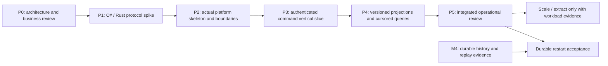

# .NET platform implementation sequence

Purpose: make architecture review and implementation order explicit before creating the platform solution.
Status: Architecture accepted and P2 bootstrap authorized, 2026-10-17; later capabilities remain planned. Owner/approver: project maintainer. This document tracks order/gates; the current fail-closed scaffold does not complete P1/P3.

The recommended patterns and dependency graph live in [platform architecture](platform-architecture.md). [Backlog](../delivery/backlog.md) remains the only work-item tracker; phase gates here describe order/evidence, not a parallel ticket or estimate system. [ADR-0007](decisions/0007-platform-architecture.md) is accepted for the architecture/project graph; business/protocol choices remain open.

## Authorized bootstrap ordering

On 2026-10-17 the maintainer explicitly requested the solution and module scaffold before sequential implementation. P2 bootstrap therefore proceeds before P1 with empty local grants, a disabled execution adapter and health-only HTTP routes. This does not waive protocol/access gates for financial endpoints. The first application slice is trusted in-process cancel authorization/forwarding plus an experimental bounded framing utility, not authenticated Rust round-trip.

## Phase dependencies

The spike is an isolated experiment, not the production gateway. P4 may use an explicitly volatile run-scoped feed only after its contract is accepted; M4 is required for durable resumption. This sequence does not claim all of M4 must precede initial .NET development.

## P0: review the architectural baseline

Review these recommendations as one coherent design: one initial .NET deployment; module-owned state/contracts; consumer-owned ports; feature slices; Rust-only financial decisions; initially no broker or generic framework dependency; explicit worker roles. Record approval or changes in ADR-0007 before creating the long-lived application projects.

Resolve the decisions that shape public behavior, linking to the existing register rather than inventing defaults:

| Decision | Required review outcome |
| --- | --- |
| BD-01 | Principal/account grant model; read/trade/admin/funding privileges; standalone sandbox identity bootstrap |
| BD-02 | Revocation/cache cutoff; already-admitted work; authorization of retry/outcome lookup |
| BD-03 | Preserve accepted SYNBASE/SYNQUOTE constraints; specify external/display integer scales and exact mapping |
| TD-01/03 | Wire framing/encoding/version and client identity/correlation; public numeric/error/unknown-outcome contracts |
| TD-02 | Trusted gateway identity and restricted engine access; no public Permissions input |
| TD-04 | Complete batches/progress, stream/run identity, volatile restart behavior and later durable cursor compatibility |
| TD-05 | Supported .NET SDK/provider/database/test-tool versions and actual supported hosts |

P0 can define questions and provisional spike options while P1 gathers evidence. The long-lived implementation contract is accepted only after the required review and evidence; publishing a plan does not constitute approval. Exact endpoint names, HTTP statuses and serialization are not frozen in this plan.

## P1: isolated protocol experiment

Prove a minimal C# client and restricted Rust adapter can round-trip a bounded typed command/result without putting async/network code into matching/ledger. Compare the existing framed loopback TCP direction with one encoding choice and document alternatives; do not build a full gateway or authentication platform inside the spike.

Required evidence: exact integer boundaries (including u64 values beyond JavaScript's exact integer range), partial reads, zero/oversized/truncated/malformed frames, unsupported versions, correlation under concurrent calls, disconnect before/after send, timeout after admission, same-ID retry and changed-payload conflict. Demonstrate a business rejection with a sequence and no event batch, and a retained outcome that is not republished. A transport adapter must expose known admission/business results separately from unknown transport outcomes.

Define pending-request/queue/frame bounds, ownership of the connection read/write loops, and the initial ordering/multiplexing policy. Never assume one read is one frame. No same-process FFI or shared-memory IPC is required by this experiment. Capture results in research using the existing experiment template; update protocol/security contracts and close relevant TD entries with an ADR.

Exit: reproducible Linux/Windows spike evidence for the chosen supported hosts, explicit unresolved limitations, and an accepted wire/trust/identity baseline sufficient for P2/P3. Network output remains non-durable until M4.

## P2: create the real platform baseline

Use the existing proposed .NET 10 LTS family baseline; select/pin a supported exact SDK and compatible packages at implementation. Create only the projects needed for the first authenticated command path: Platform host, Access core, Access.Infrastructure, Trading use cases and ExecutionClient adapter. Add the solution, global.json, aligned NuGet versions, nullable analysis, analyzers, test projects and Linux/Windows .NET CI together. Shared build/package settings have one documented owner/location and must follow repository naming conventions. Add no empty worker/deployment projects.

Add architecture tests for allowed project references, no framework/ORM dependencies in application/domain boundaries, no cross-module storage access, and narrow public contracts. Add module registration and validated runtime configuration; secrets are external and redacted. Ops gains logged restore/build/test/run tasks and service readiness/shutdown behavior when there is an executable service, with the required Windows runner regression checks.

Recommended test approach: a supported [xUnit baseline](https://xunit.net/docs/getting-started/v3/getting-started) for use-case/policy tests, [ASP.NET Core integration hosting](https://learn.microsoft.com/en-us/aspnet/core/test/integration-tests?view=aspnetcore-10.0) for endpoint/auth behavior, and real PostgreSQL integration tests for transactions/cursors. Exact package versions are chosen with the SDK/provider compatibility check. EF's in-memory provider is not evidence of PostgreSQL locking, migrations or transactional behavior; see [EF Core testing guidance](https://learn.microsoft.com/en-us/ef/core/testing/choosing-a-testing-strategy). Fakes validate port/use-case behavior; real adapters validate the cross-process/storage boundary.

Exit: actual source compiles and tests, architecture rules fail on a forbidden dependency, host startup/configuration errors are actionable, docs/ops instructions run, and all required hosted workflows pass. An empty health endpoint alone does not complete this phase.

## P3: deliver one authenticated financial command slice

Implement enough access/key/grant behavior to authenticate and authorize the sandbox without requiring Aegis. First slice: an explicitly privileged synthetic funding action followed by place/retry/cancel through the gateway. Endpoint transport maps to Trading contracts; the Trading authorization port checks account/action independently of any skipped HTTP middleware; ExecutionClient translates to the accepted Rust contract.

Keep the domain's two decision classes and transport uncertainty distinct. Proposed application outcomes include known admission failure, known business rejection, completed result, unavailable-before-send and unknown-after-send. Exact public codes are a protocol decision. Client cancellation/connection failure cannot reverse a possibly completed Rust command. A retry preserves its command identity and semantic payload; a gateway does not mint a replacement intent automatically.

Acceptance: read-only key cannot place; wrong account cannot cancel or query; trader cannot fund/pause; revoked credentials follow the accepted cutoff; retained success/rejection remains original; no duplicate postings/events on retry; two gateway callers cannot spend the same funds twice; transport failure is not mislabeled insufficient funds/rejection. No .NET service computes reserve/settle or approves spend from PostgreSQL.

Exit: authenticated in-process and cross-process tests plus a reproducible volatile end-to-end demo. This demonstrates M3 access/command behavior, not durable recovery.

## P4: projections and read APIs

Add ReadModels and its infrastructure only when the complete-batch/feed contract exists. Define projection schema/version, source identity, cursor and rebuild horizon. Apply effects plus progress atomically; test duplicate/reordered/gapped/no-event batches, restart mid-transaction, schema migration and unauthorized queries. Expose applied cursor and source identity so clients can assess lag.

Start with one active ordered projection worker per version. Explicitly disable worker role in additional API replicas. A volatile M3 source restart requires accepted invalidation/rebuild behavior and visible unavailable/stale status; do not silently reinterpret a reused sequence as the old source. Durable catch-up, retention and original receipt restoration require M4 and separate crash tests.

Exit: real PostgreSQL integration evidence, transaction/cursor correctness, visible lag, safe rebuild instructions and no projection-to-execution mutation path. Market-data WebSocket/snapshot/delta delivery remains M5.

## P5: operational review before scaling

Run the actual service stack through ops with redacted logs, meaningful readiness, owned-process cleanup, graceful shutdown and force-stop drills. Check access-store outage, engine unavailability/unknown outcomes, projection lag/DB outage, queue exhaustion and worker failure. Define which capabilities remain available for each failure; avoid one undifferentiated health signal.

Measure separate auth/admission, queue, transport, core, response and projection boundaries with revision/seed/workload/environment metadata. Initially establish measurements and bounds rather than arbitrary latency targets. Record CPU/memory, retained state, pending requests and consumer lag. Benchmark only behavior the implementation actually provides; a volatile number is not durable throughput.

Exit: end-to-end evidence, documented limitations, runnable failure procedures and re-estimated next milestone. The full funding -> partial fill -> retry -> restart -> cancel -> reconcile acceptance additionally requires M4 durability evidence.

## Gates for later scale/extraction

| Proposed change | Evidence required before implementation |
| --- | --- |
| Separate projection/market-data worker | Actual contention/failure coupling; independent worker supervision and ordered cursor ownership |
| More API replicas | Shared access/revocation policy, trusted engine connections, same-ID retry across replicas, bounded aggregate ingress, workers not duplicated accidentally |
| Query cache/read replica | Explicit staleness/source cursor, invalidation and sensitive-data authorization; no financial authority |
| Message broker | Concrete fan-out/retention need, delivery/ordering/idempotency contracts, operational ownership; preserve durable engine history |
| Extract Access or ReadModels | Stable contract, owned data, independent deployment need, migration/rollback, failure tests and observed benefit |
| Replicated/sharded execution | New reservation/commit authority, fencing, replay/failover and shared-asset invariants; separate ADR |

None is triggered by folder count or assumed future popularity. Each expansion needs a measured constraint or reviewed business requirement and an operationally supportable failure model. [Backlog](../delivery/backlog.md) holds the corresponding work items; [decision register](blueprint/decision-register.md) holds choices still awaiting review.

## Plan validation

Verified on 2026-10-16: local documentation links, UTF-8/final newlines, naming and Git whitespace checks pass; all three new Mermaid views render. This checks documentation integrity, not delivery of the proposed platform. No .NET build or architecture-test success is claimed before real projects exist. Required hosted workflows remain the publication gate.
