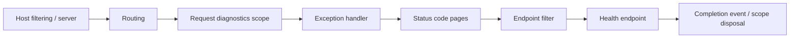

# Platform HTTP pipeline and diagnostic logging

Status: Implemented scaffold, 2026-10-20. Scope: health-only HTTP host and local debug operations; authenticated financial endpoints remain pending.

## Ownership and layout

The host owns HTTP concerns. Access and Trading remain framework-independent; middleware never authorizes funds or modifies Rust state.

| Folder | Responsibility |
| --- | --- |
| Composition | Explicit service registration and ordered pipeline assembly |
| Endpoints | Route groups and HTTP result mapping; health routes currently exist |
| Middleware | Request-wide identity, diagnostic scope and completion timing |
| Errors | Unexpected-exception translation using IExceptionHandler |
| Filters | Endpoint-specific policies; NoStoreEndpointFilter protects health responses |
| Diagnostics | Immutable process identity and the JSON console formatter |

Do not create a shared framework project for host-only code. Introduce a reusable package only when another real host needs the same contract. Do not add authentication stubs, financial DTO filters, general response envelopes or an empty controller hierarchy before their contracts exist. Business validation belongs in application handlers; HTTP input validation belongs with the corresponding endpoint. Future authentication/authorization must run before financial handlers and have explicit fail-closed tests.

## Pipeline ordering

Routing resolves a template before diagnostics. Diagnostics wraps exception/status translation so completion sees the final status. The no-store filter applies only to the health group. Problem Details supplies a consistent response for otherwise empty error responses such as unknown routes; it does not replace existing readiness JSON or business outcomes. Low-level server/host-filtering rejections can occur before this application pipeline and need not have application correlation headers.

Every application request receives a newly generated X-Request-ID. Incoming X-Request-ID values are ignored. X-Trace-ID exposes the current W3C trace ID, with a generated fallback outside an Activity. ASP.NET Core can continue an incoming traceparent; it is untrusted correlation, never identity, authorization or idempotency. Request IDs and trace IDs must not become trading command IDs.

## JSON record contract

The Cinis formatter writes one JSON object per console line; embedded newlines are escaped. All records have UTC Timestamp, Service, Environment, Version, ProcessId, RunId, LogLevel, Category, EventId, EventName, Message, Fields and Scope. Version uses assembly informational version, including build source identity when available. The run ID comes from validated CINIS_RUN_ID supplied by the operations runner; direct launches generate an independent ID. Startup events therefore retain process/run identity even without a request scope.

| Event | Level and fields |
| --- | --- |
| 1000 / RequestCompleted | Information for success, Warning for 4xx, Error for 5xx; Method, Route template, StatusCode, ElapsedMilliseconds, Outcome |
| 1001 / RequestFailed | Error; ExceptionType and StackTrace, without exception message, Data or nested exception objects |

Scope exports only Service, Environment, Version, ProcessId, RunId, RequestId, TraceId, SpanId and ParentId. Framework scopes containing raw paths are excluded. Completion events record route templates or unmatched, never query strings, arbitrary unknown paths, headers, remote addresses or bodies. Keep new application event fields deliberate: the formatter is a scope allowlist, not a general-purpose secret detector for arbitrary messages or structured event fields. Never pass secrets to ILogger. Other future sinks must implement equivalent controls and tests.

appsettings.json reduces Microsoft.AspNetCore events to Warning to avoid duplicate framework request-start/end records and raw URL logging. Cinis events remain Information by default. Standard Logging__LogLevel__... configuration can override category levels; enabling framework Debug/Information can expose URL/message details despite scope filtering. Use narrow Cinis categories when diagnosing application behavior. Configuration changes should be reviewed before sharing logs.

## Error and cancellation behavior

Unexpected exceptions before a response starts become a 500 application/problem+json response with generic title, code=internal_error, requestId and traceId. Exception text and stack frames are never returned to callers, including Development. The handler records one explicit diagnostic error; .NET 10 suppresses its framework duplicate by default. Completion is a separate event describing duration/status, not a second exception dump.

Caller-aborted operations are not translated into financial rejection or rollback. ASP.NET Core/the diagnostic boundary records 499 where a response has not started. A response that has already started cannot safely be rewritten; unhandled failures propagate to the server and completion records Outcome=Unhandled with diagnostic status 500. A diagnostic status is not proof that those bytes reached the caller. Elapsed time measures application pipeline execution, not network delivery or execution-core latency.

Health responses use Cache-Control: no-store. Liveness stays 200 and readiness stays 503/execution_not_configured. No public fault/debug endpoint is shipped; fault routes exist only in tests.

## Local operation and evidence

Use [logging operations](../operations/logging.md) for stable overwritten files, archive mode, locking and live tail commands. The application writes to console; the runner captures it. This avoids two independent file writers and keeps hosting portable. No additional logging NuGet dependency or database is required.

Tests cover correlation and incoming-ID rejection, W3C continuation, route-template privacy, formatter escaping/scope filtering, generic correlated 500/404 responses, client cancellation and health no-store behavior. These tests exercise the same composition methods as Program; InternalsVisibleTo grants only the integration test assembly access to internal composition, without public test hooks or production fault routes.

This is a local diagnostic foundation. Export to an OpenTelemetry collector, sampling/retention, production file rotation, distributed trace propagation to Rust and durable security auditing need separate implemented service contracts and evidence. See [platform guide](platform.md), [architecture](../architecture/platform-architecture.md) and [backlog](../delivery/backlog.md).

## Primary references

- [ASP.NET Core logging and scopes](https://learn.microsoft.com/en-us/aspnet/core/fundamentals/logging/?view=aspnetcore-10.0)
- [Error handling and .NET 10 handled-exception diagnostics](https://learn.microsoft.com/en-us/aspnet/core/fundamentals/error-handling?view=aspnetcore-10.0)
- [Minimal API endpoint filters](https://learn.microsoft.com/en-us/aspnet/core/fundamentals/minimal-apis/min-api-filters?view=aspnetcore-10.0)
