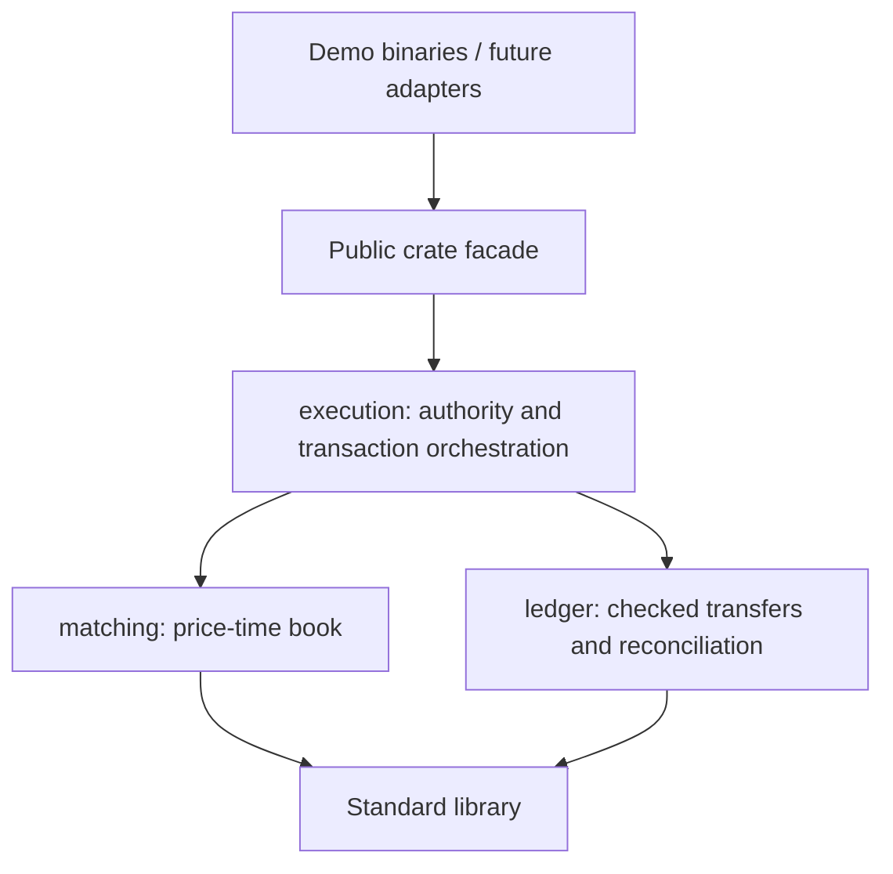

# Rust engine development architecture

Purpose: make the execution crate understandable and maintainable as matching, finance and adapters grow.
Status: Implemented module convention and additive outcome API, 2026-10-16. Owner: repository maintainer.

## Design rules

Keep one deterministic financial owner. Use cohesive private modules inside one dependency-free safe-Rust crate while there is one deployment-independent execution domain. A module is a privacy boundary, not another service. Add a crate when dependencies, reuse, release or runtime ownership justify that boundary; file size alone is not a reason to split Cargo packages.

The public facade stays in lib.rs and execution/mod.rs. Internal source paths may evolve without forcing callers to import storage/planning details. Existing root imports and execution/ledger public type paths remain compatible. Public matching Engine is explicitly a research primitive, not a gateway financial entry point.

The [Rust module guide](https://doc.rust-lang.org/book/ch07-02-defining-modules-to-control-scope-and-privacy.html) explains privacy and module trees. Cinis uses private children with explicit reexports, and places owned state in their parent so implementation children can work without exposing mutable fields. This is a project convention, not a claim that Rust mandates one folder style.

## Source map

```text
src/engine/
  Cargo.toml                 package, binary targets and safety/rustdoc lints
  Cargo.lock                 committed application dependency resolution
  src/
    lib.rs                   public facade, runnable crate example
    main.rs                  synthetic financial demo
    bin/matching_demo.rs     raw matching-only demo
    matching/
      mod.rs                 private Engine fields and type reexports
      types.rs               commands/events, orders, sides and limits
      book.rs                matching preflight and mutation
      invariants.rs          full order/priority/book audit
    ledger/
      mod.rs                 private ledger fields, immutable internal views
      types.rs               asset/balance/transfer value types
      error.rs               private failures, no execution dependency
      mutation.rs            checked per-asset transfers
      invariants.rs          independent aggregation and conservation
    execution/
      mod.rs                 sole owner fields, receipts and public facade
      types.rs               envelopes, outcomes, permissions, limits, error mapping
      core.rs                authorize, deduplicate, sequence, commit and retain
      invariants.rs          receipt, event and posting identity audit
      tests.rs               private counter/configuration boundary tests
      state/
        mod.rs               private state and immutable public views
        transition.rs        command-to-financial-state orchestration
        settlement.rs        fill and price-improvement transfers
        invariants.rs        book/ledger/active-reservation reconciliation
  tests/
    scenarios.rs             exact shared matching fixtures
    differential.rs          independent matching reference model
    financial.rs             exact financial and rollback scenarios
    financial_properties.rs  deterministic generated financial streams
    outcomes.rs              new/retained outcome contracts for adapters
```

No empty transport, persistence or service package is created in advance. Public documented domain types can share a cohesive types.rs; do not create a file for every enum. Split when readers otherwise have to reason about unrelated responsibilities together.

## Dependency direction



Internal imports name their owner module explicitly instead of depending on root compatibility exports. Ledger returns private LedgerError values; execution maps them exhaustively to unchanged public ExecutionReject variants. Ledger must not import execution, networking, database, clock or logging libraries. Matching has no ledger/management dependency.

Mutating ledger operations are not individually rollback-safe. They are private, operate only on tentative ExecutionState, and may leave tentative changes on error. ExecutionCore discards that entire transaction. Do not expose them to adapters or add a direct write path that skips rollback/reconciliation. Ledger accounts/history fields are private; execution receives immutable views and checked mutation methods.

## Command walkthrough

1. execution/core.rs checks envelope identity and trusted permissions before inspecting a receipt.
2. Same account/key and equal typed command retrieves its original result. A different payload conflicts without sequence mutation.
3. A fresh admitted command acquires the next sequence and clones tentative state.
4. state/transition.rs dispatches commands. Matching plans on an isolated book; ledger reserves and posts under checked limits.
5. state/settlement.rs posts quote, price improvement and base transfers in the accepted order.
6. state/invariants.rs checks matching/ledger correctness and hold equality. Success swaps tentative state; business failure leaves financial state unchanged.
7. The owner retains either business outcome and advances sequence. execution/invariants.rs additionally audits receipt/event/posting relationships.
8. The caller receives a stable response and, if requested, invocation source. No I/O or event publication occurs inside this path.

Preserve authorization-before-dedup, matching priority versus command sequence, rejection caching, event/posting ordinals, and zero mutation on admission errors. Whole-state copying/full audits remain the current correctness baseline.

## Safe adapter seam: classify new decisions

Use execute_with_outcome when a caller needs invocation metadata:

```rust
let outcome = core.execute_with_outcome(request, permissions)?;
match outcome.source {
    DecisionSource::New => {
        // Acquired a sequence, even if response.result is Err.
        // A future progress feed must represent no-event decisions too.
    }
    DecisionSource::Retained => {
        // Return original response; do not republish historical effects.
    }
}
let response = outcome.response;
```

This excerpt requires imports and an enclosing Result-returning function; the complete example in src/lib.rs is compiled as a doctest. ExecutionResponse remains identical across retries. Invocation metadata is outside the receipt, so a retry is classified Retained without rewriting the original response. execute remains a compatible wrapper when the distinction is unnecessary.

New does not mean business success, durable commit or exactly-once delivery. Retained does not mean current order status. This API is not an outbox: an adapter can crash after a new decision but before publication. M4 must provide a durable catch-up feed; no caller should infer durable delivery from this enum.

## Extension recipes

| Change | Start here | Required follow-through |
| --- | --- | --- |
| Matching rule/order type | Accepted trading rule and matching types/book | Fixture, independent oracle, lifecycle/capacity/rejection tests |
| Fee/reservation/rounding | Financial specification and transition/settlement | Postings, holds, overflow/recipient limits, atomic rollback, generated checks, ADR |
| Financial command | execution types/core authorization and transition | Idempotency, retained reject, source classification, output budget, invariants |
| Book optimization | Private matching implementation | Exact events/state against unchanged oracle; measure actual workload |
| Transaction optimization | core/state boundary | Failure injection and financial rollback/receipt/ID equivalence |
| Network adapter | Separate runtime boundary after protocol spike | Framing, trusted context, unknown outcomes, correlation, no retry publication |
| Journal/recovery | Accepted durability and format ADRs | Full-state/receipt/config replay, crash matrix, corruption halt, compatibility |
| More markets/workers | Authority model first | Shared assets cannot be spent independently by market-local writers |

Avoid generic repository/service traits before a concrete second implementation or adapter boundary exists. Do not add an async runtime to matching/ledger for convenience. A future runtime may own a bounded queue feeding one core; concurrent clients do not require concurrent mutation of one financial state. Typed commands/events are not a wire or snapshot schema until a versioned contract is accepted.

## Documentation, checks and review

Public APIs document purpose, units, admission versus business failures, state effects, and durability limits. Prefer compiled examples over untested snippets. Follow [Rust API documentation guidance](https://rust-lang.github.io/api-guidelines/documentation.html); the crate denies broken Rustdoc links. Compiler privacy enforces access boundaries; reviewers still inspect dependency direction and business semantics.

```sh
cargo fmt --manifest-path src/engine/Cargo.toml --check
cargo clippy --locked --manifest-path src/engine/Cargo.toml --all-targets -- -D warnings
cargo test --locked --manifest-path src/engine/Cargo.toml
cargo doc --locked --manifest-path src/engine/Cargo.toml --no-deps
cargo run --locked --manifest-path src/engine/Cargo.toml --bin cinis-demo
cargo run --locked --manifest-path src/engine/Cargo.toml --bin cinis-matching-demo
```

The engine workflow runs these checks on Linux/Windows, including doctests and Rustdoc generation. Verify logs the existing format/lint/build/test/repository checks; cargo doc is also a direct documented check. Hosted five-workflow integration gating remains mandatory.

When a real boundary warrants more crates, follow [Cargo workspace guidance](https://doc.rust-lang.org/cargo/reference/workspaces.html): keep dependency flow explicit, shared toolchain/lock decisions deliberate, and CI/tasks updated together. Do not move the manifest merely to create a workspace-shaped scaffold. The next planned functional step remains the cross-language spike and business/protocol decisions in the [architecture register](../architecture/blueprint/decision-register.md).
