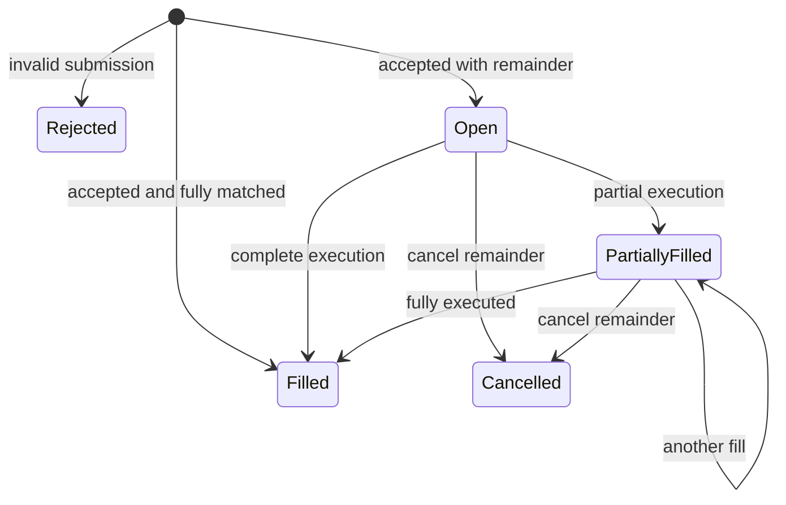

# Order lifecycle

Acceptance is a result/event, not necessarily a resting state. An immediately partially matched order rests as PartiallyFilled. Rejected submissions never enter the book or retain reservations.

Original quantity = filled + remaining + cancelled. Cancelled quantity is zero until cancellation. A fill sequenced before cancel is final; cancel before a competing order removes the remainder first. Terminal orders never reopen. Duplicate commands return their original result without another transition.
