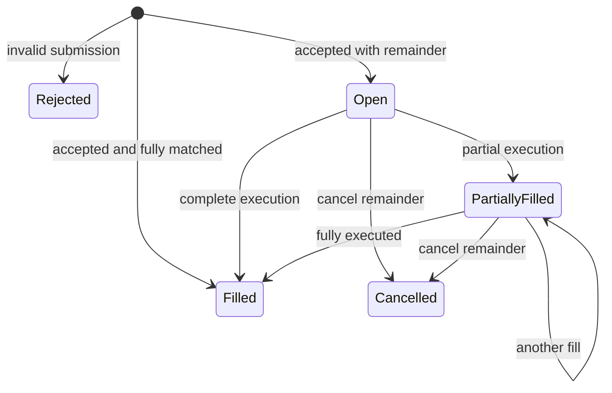

# Order lifecycle

Acceptance is a result/event, not necessarily a resting state. An immediately partially matched order rests as PartiallyFilled. Rejected submissions never enter the book or retain reservations.

Original quantity = filled + remaining + cancelled. Cancelled quantity is zero until cancellation. A fill sequenced before cancel is final; cancel before a competing order removes the remainder first. Terminal orders never reopen. Duplicate commands return their original result without another transition.

## Transition triggers

| Trigger | Result/event | State |
| --- | --- | --- |
| Valid place, no fill | Accepted | Open |
| Valid place, some fills | Accepted then Trade events | PartiallyFilled if remainder exists |
| Complete fill of maker/taker | Trade | Filled |
| Authorized cancel of remainder | Cancelled | Cancelled |
| Cancel terminal owned order | Terminal status | Unchanged |
| Invalid place/cancel | Rejection | Existing book unchanged |

Accepted, Trade, Cancelled, and Terminal are matching-core event kinds. M1 rejections are return values, not stored rejected order records. Place order IDs are distinct from later command IDs. Financial reservation/release is not implemented in M1.
